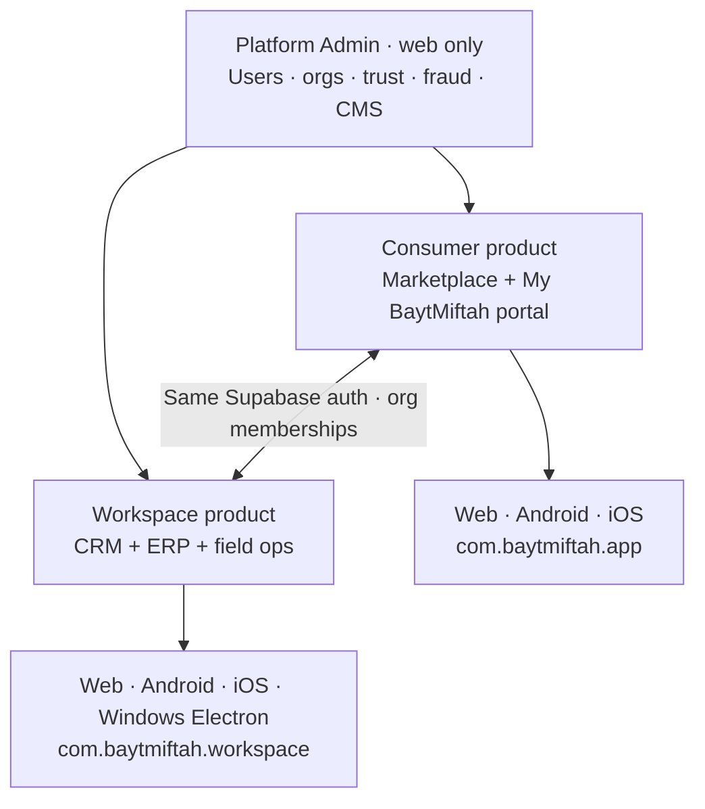
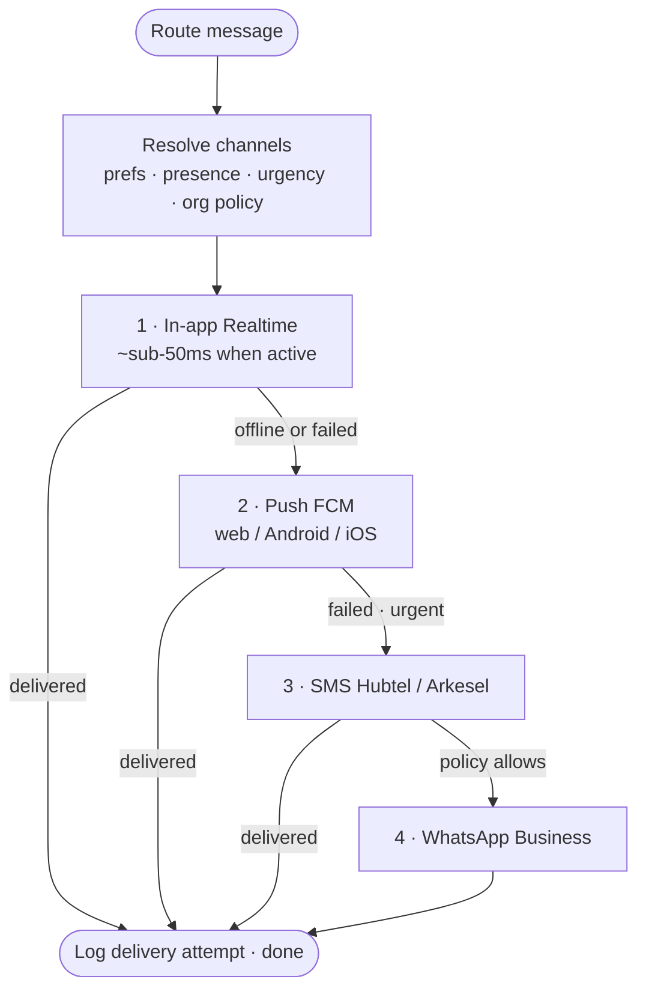

# BaytMiftah — Complete Pitch & Product Inventory

**Product:** BaytMiftah Real Estate Operating System (REOS)  
**Tagline:** Your property life and your property business—in one operating system.  
**Primary market:** Ghana (cedis, local trust, SMS/WhatsApp norms) with **international rules**, multi-currency, and cross-border listing logic where enabled.

| | |
|---|---|
| **Marketing site** | [https://www.baytmiftah.com](https://www.baytmiftah.com) |
| **Web app** | [https://app.baytmiftah.com](https://app.baytmiftah.com) |
| **Support** | support@baytmiftah.com |
| **Social** | [Facebook](https://www.facebook.com/baytmiftah/) · [Instagram](https://www.instagram.com/bayt_miftah/) · [TikTok](https://www.tiktok.com/@baytmiftah) |

---

## Executive summary (60 seconds)

BaytMiftah connects **people** who rent, buy, or book stays with **professionals** who list, lease, collect, maintain, and report on property—without juggling five different apps. One REOS codebase ships **three product families** across **eight surfaces** (consumer, workspace, and admin × web, mobile, desktop where applicable).

Consumers get discovery through checkout: search on maps, save and compare, message agents, apply, verify identity, pay, sign, lease, maintain, and book short stays—with AI and HD video when it matters. Businesses get a **CRM-to-ERP workspace**: listings, leads, leases, maintenance, estate finance, optional general ledger and procurement, Ghana-focused trust and SMS/WhatsApp omnichannel, and AI tools that read org data—not generic chatbots.

The platform runs on **React 19 + TypeScript + Supabase**, with **103 workspace modules** on a unified shell, **Capacitor** native apps, **Electron** desktop, edge functions for payments and messaging, and a **production readiness score** rubric in-repo. **Google Play** closed testing is live for the consumer app; workspace closed test is in review—path to production via Google’s 12-tester × 14-day program.

---

## The problem we solve

| Stakeholder | Pain today | BaytMiftah answer |
|-------------|------------|-------------------|
| **Renters & buyers** | Listings scattered on social; no single place for applications, payments, and documents | One **My BaytMiftah** hub from search → journey → lease |
| **Short-stay guests** | Fragmented booking and host communication | Trips, checkout, messaging, and receipts in-app |
| **Agents & landlords** | WhatsApp + Excel + paper leases | **Workspace**: listings, leads, calendar, payments, e-sign |
| **Estate & portfolio operators** | Finance disconnected from operations | **Estate finance**, GL, owner statements, disbursements |
| **Enterprise portfolios** | Need ERP depth without custom builds | Optional modules: procurement, collections, HOA/CAM, trust accounting |
| **Platform operator** | Fraud, KYC, moderation at scale | **Admin console**: trust, fraud radar, revenue, CMS, feature flags |

---

## Architecture: three products, eight surfaces

**Eight surfaces:** Admin web (1) + Consumer web/Android/iOS (3) + Workspace web/Android/iOS/Windows (4).

**Technical foundation**

- **Frontend:** React 19.2, TypeScript, Vite 6, React Router 8, Tailwind CSS 4, shadcn/ui + Radix + MUI
- **Backend:** Supabase PostgreSQL (RLS multi-tenant), Auth, Realtime, Storage, Edge Functions (Deno)
- **Native:** Capacitor 8 (push, camera, geo, biometrics, deep links)
- **Desktop:** Electron workspace build with hash routing, My Work–first home, no consumer marketplace routes
- **Quality bar:** 103/103 workspace pages on `WorkspacePageShell`; CI workspace-shell audit; Vitest + Playwright e2e

---

## Consumer product (`com.baytmiftah.app`)

### Marketing & discovery (no account required)

- **Home / marketplace index** — featured inventory and entry to search
- **Marketing website** — narrative, product tours, workflow explainers, AI story, proof band, testimonials-style proof notes (CMS-editable from admin)
- **Property search** — list and map views; filters for location, price range, property type, listing type (**rent**, **sale**, **short stay**)
- **Property detail** — galleries, amenities, pricing, enquiry, booking, and apply actions
- **Compare** — side-by-side comparison of saved listings
- **Public property explorer** — browse units/properties without signing in
- **Public event / transaction explorer** — transparency views on ledger-style events where published
- **Shared shortlist** — shareable curated lists for couples, agents, or family decision-making
- **Referral program** — growth page for invite-based acquisition
- **SEO & social** — dedicated OG/share image, theme-color and meta aligned with marketing brand

### Public workflows (token, magic link, or email/SMS)

- **Public lease application** — apply to a specific listing/estate via link
- **Public e-sign** — sign documents from outbound links without full app navigation
- **Owner / board portals** — tokenized access for property owners and HOA-style boards
- **Contractor access** — limited external portal for vendors on assigned work

### Authentication & account security

- Email/password sign-up, login, forgot password, email verification
- OAuth providers when configured in Supabase Auth
- Security settings: password change, session awareness, MFA when enabled
- Profile, legal acceptances, notification preferences under **My BaytMiftah** (`/app`)

### My BaytMiftah — signed-in consumer portal (full section list)

| Section | What users do |
|---------|----------------|
| **Overview (Home)** | Saved items, viewings, recommendations, activity feed, pending e-signatures |
| **Saved properties** | Bookmarks and shortlists from search |
| **Messages** | Realtime conversations with agents, hosts, property teams |
| **Offers & applications** | Rental, lease, and purchase deal cases with status |
| **Property journey** | Per-deal timeline: stage, next actions, documents (`/app/journey/...`) |
| **Viewings** | Request and confirm property visits |
| **Saved search alerts** | Notify when new listings match criteria |
| **Payments & wallet** | Confirmations, receipts, payment history (provider-backed) |
| **Transactions** | Deposits, installments, purchase-related activity |
| **Leases** | Active tenancies, rent context, lease-linked actions |
| **Trips & reservations** | Short-stay upcoming trips and history |
| **Documents** | IDs, leases, agreements, receipts, shared files |
| **Maintenance** | Submit and track requests; tie-in to vendor marketplace |
| **My Home (resident)** | Resident tools when on active lease (access, utilities, announcements—property-dependent) |
| **Mortgage marketplace** | Compare lenders, estimate payments, request introductions |
| **Insurance marketplace** | Home/contents quotes from partner insurers |
| **Vendor marketplace** | Verified maintenance and property services |
| **Notifications** | Central feed: bookings, payments, messages, system updates |
| **Identity verification (KYC)** | ID, liveness, AML when required for offers/bookings/high-trust actions |
| **Profile & settings** | Account, legal, notifications, workspace linkage |
| **Contextual messages portal** | Deep-linked messaging outside main dashboard chrome |
| **Workspace access** | Switch or request access to linked business orgs |

### Checkout & commerce

- In-app **checkout** for short-stay and other payable flows
- **Verified email** gates before sensitive payment actions
- Integration with configured rails (**PayAngels** primary in repo; mobile money/card when live-certified)

### Legal, trust & support (consumer-facing)

- Privacy policy, terms, **legal hub** with slugged documents
- Complaint form, **public status page**, sitemap
- Static pages: help, cancellation policy, host resources, workspace roles explainer, about, careers, contact

### Consumer UX & realtime features

- Mobile **bottom navigation** on consumer routes
- Cookie consent and **policy update** banners
- Location onboarding where relevant
- New-user **tutorial** and getting-started checklist
- **BaytMiftah AI panel** — contextual assistant on supported surfaces
- **HD voice & video (WebRTC)** — incoming call banner, active call bar, call modal; screen share and in-call chat patterns
- **256-bit encrypted** WebRTC media path (as documented in product README)

### Consumer native (Capacitor)

- Push notifications (FCM)
- Camera (listing photos, KYC capture where used)
- Geolocation (search near me)
- Haptics, in-app browser, **deep links** into journeys
- Optional **biometric unlock** on supported devices

---

## Business Workspace (`com.baytmiftah.workspace` + web + desktop)

### Getting in & governing access

- **Workspace entry** — pick organization; role-aware landing
- **Accept invite** — join from email/link
- **Enrollment status** — B2B onboarding pipeline for new companies
- **Desktop gateway** — entry path tuned for Electron users
- **Company setup wizard** — first-time owner configuration
- **Multi-organization switching** — one login, many orgs

**Access model:** Organization-scoped **RBAC**—owner, admin, agent, finance, maintenance, custom roles, platform-admin viewer modes. Members can be **scoped to property subsets**. Orgs customize **navigation**, **terminology presets**, hidden modules, and default home (web vs desktop My Work).

### Core operations modules (daily work)

| Module | Capability |
|--------|------------|
| **Dashboard** | Executive and role dashboards; KPIs and work queues |
| **Listings** | Create/edit/publish; media; compliance gates before go-live; **new listing wizard** |
| **Leads** | Enquiries vs applications; pipeline and assignment |
| **Contacts** | CRM: clients, tenants, owners |
| **Tasks** | Operational tasks tied to deals and properties |
| **Calendar** | Viewings, inspections, scheduling |
| **Payments** | Collect rent/fees; tie to finance modules |
| **Team** | Members, roles, invites, permissions |
| **Documents** | Org library and sharing |
| **Leases** | Lifecycle, terms, renewals, commercial escalations |
| **Maintenance** | Work orders, vendors, resident requests |
| **Inspections** | Move-in/out and periodic inspections |
| **My Work queue** | Personal approvals and tasks (desktop home emphasis) |
| **Estate operations** | Day-to-day estate/property ops |
| **Estate finance** | Property-level finance, payables, owner statements, disbursements |
| **Company launchpad** | Guided go-live checklist for new businesses |

### Tools, intelligence & automation

| Module | Capability |
|--------|------------|
| **Market intelligence / analytics** | Portfolio and market dashboards |
| **Ghana Trust Center** | Local trust signals and verification workflows |
| **Compliance center** | Regulatory and policy tracking |
| **International rules hub** | Cross-border listing and transaction rules |
| **Automation workflows** | Event-driven rules and notifications |
| **Automation builder** | Visual/automation configuration |
| **Module marketplace** | Enable optional workspace modules per org |
| **AI assistant** | NL help and actions in workspace context |
| **AI lease analyzer** | Summarize and flag lease documents |
| **AI rent yield predictor** | Yield and pricing insights |
| **AI command center / estate AI ops** | Orchestrated AI across org operations |
| **Command center** | Operations command surface |
| **Location intelligence** | Geo and neighborhood insights |
| **Organization insights** | Org health and usage analytics |
| **Integration hub** | External systems and APIs |
| **Blockchain verification** | Optional on-chain attestation of selected transactions |
| **Customize workspace / settings** | Branding, nav, terminology, visibility |
| **White-label config** | Partner branding where entitled |
| **Notification settings** | Channel preferences |
| **Mobile app settings** | Workspace mobile-specific options |

### Enterprise, finance & ERP-style modules

These modules target portfolios that need **accounting-grade** depth (strongest on **Windows desktop**, available on web when entitled):

- **General ledger**, **chart of accounts admin**, **journal entry manager**
- **Financial statements viewer**, **bank reconciliation**, **opening balance import**, **payment import**
- **Procurement center**, **estate payables**, **owner disbursements**, **owner oversight**, **owner statements**
- **Portfolio analytics**, **collections cases**, **trust accounting**
- **Leasing applications** (back-office), **tenant screening center**
- **HOA management**, **CAM billing**, **utility submetering**
- **Contractor 1099 reporting**, **commercial lease escalations**
- **Multi-currency / FX hedging hub**, **exchange rates** (edge-backed where configured)
- **Bulk operations**, **data import/export**, **data migration**
- **Approval center**, **exception center**, **evidence center**, **workflow approval hub**
- **Custom workflows builder**
- **Customer health center**, **customer 360**, **property 360**, **unit 360**
- **Service desk**, **stakeholder portals**, **contextual inbox hub**
- **Estate communications** — broadcast and targeted resident/owner notices
- **WhatsApp automation hub** — lead and alert automation
- **Team collaboration hub**, **team chat**, **staff time tracking**
- **Contractor portal**, **contractor work orders**, **technician jobs**, **gate clearance kiosk**
- **Vendor management**, **e-signature center**
- **Fraud alerts** (org-level), **data retention center**, **company knowledge hub**
- **Productivity workspace**, **advanced search**, **predictive analytics**, **recommendation engine**
- **Enterprise operations**, **field inspection engine**
- **Workspace smart property** — IoT-style controls where integrated
- **Purchase negotiation panel**, **payment checkout** (workspace-side collections)
- **Host tools** — short-stay operator workflows where enabled

### Workspace communications stack

**Omnichannel router** (implemented in `omnichannel-router.service.ts`) tries channels in order, then escalates when the user is offline or priority is higher:

| Step | Channel | When |
|------|---------|------|
| 1 | **In-app** Supabase Realtime | User active in app |
| 2 | **Push** FCM | Web/Android/iOS backgrounded |
| 3 | **SMS** Hubtel / Arkesel | Urgent operational notices |
| 4 | **WhatsApp Business Cloud** | Property alerts, automated lead updates |

Also: delivery attempt logging, escalation policies, branded **Resend** email for invites and notices, **HD voice/video** and screen share for team and client conversations.

### Windows desktop product

- Packaged **BaytMiftah Workspace** for field and back-office power users
- Hash routing for offline-capable field scenarios
- Workspace-only entry (no consumer marketplace routes)
- **My Work** as default home; full ERP module set exposed

---

## Platform Admin (`/admin`)

Restricted to platform staff with granular console grants.

| Area | Functions |
|------|-----------|
| **Overview** | Platform KPIs and staff dashboard |
| **App & API health** | Operations monitoring |
| **Marketing CMS** | Edit public marketing sections, intros, proof notes; preview |
| **App roles** | Platform role assignments |
| **Team roster** | Internal staff directory |
| **Integrations** | Platform-level integration config |
| **Feature flags** | Toggle AI, WhatsApp, and other capabilities |
| **Payments** | Platform payment configuration |
| **Communications** | Platform messaging settings |
| **AI** | Platform AI policies and tools |
| **Users** | Search, support actions, account management |
| **Organizations** | Enrollments, detail, access dialogs |
| **Listings** | Moderation and platform-wide listing tools |
| **Moderation** | Content and listing queue |
| **Fraud radar** | Fraud detection dashboard |
| **Trust & KYC** | Identity and trust review |
| **Revenue** | Revenue management console |
| **Support** | Support tooling |
| **Settings** | Platform settings, backups, enrollment requests |

Legacy admin routes remain under catch-all routing for backward compatibility.

---

## Integrations & external services

| Domain | Providers / capability (when configured) |
|--------|----------------------------------------|
| **Payments** | PayAngels (initialize, verify, webhook, refund, disbursement); reconciliation helpers in edge layer |
| **KYC / identity** | Prembly sessions/webhooks; Smile Identity verify/webhook; AI screen edge function |
| **SMS** | Hubtel, Arkesel (`send-sms` edge) |
| **WhatsApp** | Cloud API, webhooks, bot core, lease-sign flows, dedupe & privacy helpers |
| **Email** | Resend (transactional templates, org invites, enrollment) |
| **E-sign** | DocuSign envelope creation (edge) |
| **Banking / feeds** | Bank feed sync edge function |
| **Blockchain** | Polygon transactions edge (optional attestation flows) |
| **Listing syndication** | Syndication edge + shared listing-syndication logic |
| **FX** | Exchange rates edge |
| **AI / LLM** | Shared LLM provider abstraction in edge; `ai-assistant`, `parse-search-query`, `kyc-ai-screen` |
| **Voice (legacy/alternate)** | Twilio shared helpers where referenced |
| **Maps** | OpenStreetMap and related services for search |
| **App versions** | `app-version` edge for force-update/min-version checks |

---

## Backend & edge automation (inventory)

**Supabase Edge Functions** (representative set shipped in repo):

- **Payments:** `initialize-payangels-payment`, `verify-payangels-payment`, `payangels-webhook`, `initiate-payangels-refund`, `initiate-payangels-disbursement`, `cancel-short-stay-booking`
- **Comms:** `dispatch-notification`, `send-sms`, `send-whatsapp`, `whatsapp-webhook`, `send-organization-invite`, `send-enrollment-notification`
- **KYC:** `kyc-prembly-session`, `kyc-prembly-verify`, `kyc-prembly-webhook`, `kyc-smile-verify`, `kyc-smile-webhook`, `kyc-ai-screen`
- **Automation:** `automation-dispatcher`, `import-data-extract`
- **Platform:** `platform-health`, `platform-backup`, `admin-delete-account`, `app-version`
- **AI / search:** `ai-assistant`, `parse-search-query`
- **Integrations:** `listing-syndication`, `sync-bank-feed`, `create-docusign-envelope`, `polygon-transactions`, `exchange-rates`

**Data layer:** PostgreSQL holds multi-tenant orgs, listings, deal cases, leases, ledger entries, communications, audit trails, delivery attempts, escalation policies—access enforced with **RLS**.

**Realtime:** Live messaging and presence on Supabase channels where enabled.

---

## Cross-cutting capabilities (deep dive)

### Identity & security

- Supabase Auth; email verification gates on sensitive flows
- Organization invites and enrollment pipelines
- Org and platform **role models**; property-scoped membership
- RLS-backed data access; security pipeline & matrix documentation in-repo
- Rate limiting and audit logging patterns in edge shared libs
- Branch protection and security release gate docs

### Payments & ledger behavior

- Consumer checkout and workspace payment recording
- Installments and deposits on purchase journeys
- Platform fee and promo pricing shared logic
- Reconciliation utilities for payments and refunds
- Ghana-first rail (PayAngels) with certification path documented in `PRODUCTION_SCORE.md`

### Documents & e-sign

- Consumer and workspace document stores
- Public sign links; PDF viewing in-app
- Lease e-signature workflows; WhatsApp-assisted lease sign helpers

### AI & agentic patterns

- Marketing and in-app AI panel
- Workspace assistant, lease analyzer, rent yield predictor, command center
- **REOS-QL / database-aware copilot** patterns—natural language routed to structured queries where implemented
- Draggable AI copilot concept (multi-dialect query engine per README)

### Internationalization & markets

- Multi-language UI bundles across many locales
- International rules hub for cross-border compliance UX
- Multi-currency display and hedging hub module

### Legal & compliance (in product and in repo)

- In-app legal hub, cookie consent, complaint intake
- Marketplace disclaimers; B2B enrollment terms for workspace orgs
- **Legal coverage matrix**, launch checklist, sign-off workflow
- Jurisdiction gates for GH-only transactional flows where configured

---

## Engineering, DevOps & quality (what’s built)

### UI & design system

- **UI Waves 2–5:** Consumer journey hub; standardized shells across workspace
- **103/103** workspace modules pass `WorkspacePageShell` audit (`npm run` / CI artifact)
- `OperationalQueryState` patterns for loading/empty/error on operational pages
- Dialog/Sheet on high-traffic flows; `docs/design/UI_PATTERNS.md`
- Marketing brand pass: tours, workflow/AI/proof styling, journey skeleton, footer/nav, OG card

### Testing & CI

- **Vitest** unit tests (including marketing CMS schema/backfill tests)
- **Playwright** e2e: consumer funnel, marketing carousel
- Workspace shell audit in GitHub Actions
- Legal catalog tests; tenant isolation tests (gated env flag)
- Production check script: scored rubric (`docs/deployment/PRODUCTION_SCORE.md`)

### Mobile & desktop delivery

- **Capacitor** dual apps: consumer vs business `capacitor.config` / Android projects (`android`, `android-business`)
- Release signing Gradle scripts; local `play-keystores` path for dev AABs
- Scripts: `android-bundle-release`, Play upload helpers, `consumer-after-upload-key-reset.ps1`, local upload server for browser AAB upload
- **Electron** workspace packaging for Windows
- iOS sync/open scripts; Xcode Cloud docs in deployment folder
- Apple store asset READMEs under `marketing/apple/`

### Configuration & secrets hygiene

- Supabase auth redirect script for mobile package IDs
- GitHub Actions: `PLAY_*` keystore secrets wiring from env template
- Ops: backup S3, alert webhooks, integration wire scripts documented (operator-filled secrets—not committed)

### Documentation corpus (operator-ready)

Deployment guide, release runbook, launch operator runbook, mobile setup, Google/Apple upload guides, store screenshots checklist, app review demo script, pilot playbooks, incident/support runbooks, API keys matrix, AWS migration prep, stub registry for honest “beta vs live” labeling.

---

## Go-to-market & distribution status

### Brand & digital presence

- Production marketing and app hosts live
- Social profiles active (Facebook, Instagram, TikTok)
- Store listing copy packages: `marketing/google-play/`, `marketing/apple/`

### Google Play Console (Infinitek developer account)

| App | Package | Highlights (Nov 2026) |
|-----|---------|------------------------|
| **BaytMiftah (Consumer)** | `com.baytmiftah.app` | Store listing **published Nov 2, 2026**; **Closed testing Alpha active** — release **1 (1.0)**, 178 countries, **Test1** email list; internal track path for **1.0.1** after upload key valid |
| **BaytMiftah Workspace** | `com.baytmiftah.workspace` | Listing **approved** (House & Home; financial-features declaration aligned); **closed test 1.0.2** submitted; **Test1** testers saved |

**Google production access (both apps):** Run closed test with **≥12 opted-in testers** for **≥14 days**, then **Apply for production** and answer Google’s closed-test questionnaire.

**Closed-test opt-in URLs:**

- Consumer: [https://play.google.com/apps/testing/com.baytmiftah.app](https://play.google.com/apps/testing/com.baytmiftah.app)
- Workspace: [https://play.google.com/apps/testing/com.baytmiftah.workspace](https://play.google.com/apps/testing/com.baytmiftah.workspace)

**App review aids:** Sign-in instructions for restricted demo accounts; photo/video permission declarations; privacy URL on baytmiftah.com; content rating and data safety questionnaires completed for consumer submission bundle.

### Apple App Store

- Asset and metadata structure prepared under `marketing/apple/`; Capacitor iOS project and Xcode Cloud documentation—submission path parallel to Play (operator-driven).

---

## Pitch scripts by audience

### Renters, buyers & guests

“Search on the map, save and compare homes, chat or video-call your agent, apply and sign online, pay deposits or book a stay, and track everything—leases, maintenance, trips—in **My BaytMiftah**. When you need help, **BaytMiftah AI** and real people are in the same app.”

### Agents, landlords & estate managers

“Publish compliant listings, work leads in a pipeline, schedule viewings, generate leases, collect rent, dispatch maintenance, and message residents on **WhatsApp or SMS** when they’re not in the app—all in **Workspace**. Turn on finance modules when you outgrow spreadsheets.”

### Enterprise & portfolio CFOs

“Optional **GL, bank rec, procurement, owner statements, trust accounting, and multi-currency**—same login as your leasing team. **Audit trails**, approval centers, and fraud alerts built for scale.”

### Investors & strategic partners

“**One REOS codebase**, three monetizable surfaces, **103 workspace modules**, native mobile + desktop, Supabase backend, Ghana omnichannel moat, AI differentiated on **property data**, Play Store traction on consumer closed test, legal/compliance artifacts in-repo—not vaporware docs.”

### Regulators, banks & app review

“House & Home positioning; transparent privacy policy; KYC only when required; complaint and status pages; no mis-declared financial features; deterministic sub-ledger and reconciliation patterns documented for payment partners.”

---

## Appendix A — Workspace page module catalog (103 audited modules)

Each module below is a routable workspace page using the shared **WorkspacePageShell** pattern (audit: 103/103).

Advanced Search · AI Assistant · AI Command Center · AI Lease Analyzer · AI Rent Yield Predictor · Approval Center · Automation Builder · Automation Workflows · Bank Reconciliation · Blockchain Verification · Bulk Operations · Calendar Operations · CAM Billing · Chart of Accounts Admin · Collections Cases · Command Center · Commercial Lease Escalations · Company Knowledge Hub · Company Launchpad · Compliance Center · Contextual Inbox Hub · Contractor 1099 · Contractor Portal · Contractor Work Orders · Customer 360 · Customer Health Center · Customize Workspace · Custom Workflows Builder · Data Import Export · Data Migration · Data Retention Center · Enterprise Operations · E-Signature · Estate AI Operations · Estate Communications · Estate Finance · Estate Operations · Estate Payables · Evidence Center · Exception Center · Field Inspection Engine · Financial Statements Viewer · Fraud Alerts · Gate Clearance Kiosk · General Ledger · Ghana Trust Center · HOA Management · Integration Hub · International Rules Hub · Journal Entry Manager · Lead Management · Leasing Applications · Location Intelligence · Market Intelligence · Mobile App Settings · Module Marketplace · Multi-Currency Hedging Hub · My Work Queue · Notification Settings · Opening Balance Import · Organization Insights · Owner Disbursements · Owner Oversight · Owner Statements · Payment Checkout · Payment Import · Portfolio Analytics · Predictive Analytics · Procurement Center · Productivity Workspace · Property 360 · Purchase Negotiation Panel · Recommendation Engine · Service Desk · Staff Time Tracking · Stakeholder Portals · Team Collaboration Hub · Technician Jobs · Tenant Screening Center · Trust Accounting · Unit 360 · Utility Submetering · Vendor Management · WhatsApp Automation Hub · White-label Config · Workflow Approval Hub · Workspace Contacts · Workspace Dashboard · Workspace Documents · Workspace Finance · Workspace Inspections · Workspace Leads · Workspace Leases · Workspace Listings · Workspace Maintenance · Workspace New Listing · Workspace Payments · Workspace Settings · Workspace Smart Property · Workspace Tasks · Workspace Team · Workspace Team Chat

*(Entry/layout/gateway/wizard pages exist for routing but are excluded from the shell audit count.)*

---

## Appendix B — Consumer route themes (conceptual)

Marketing & static legal · Search & map · Listing detail & compare · Public apply/sign/portals · Auth · `/app/*` portal sections listed above · Checkout · AI & calls overlay · Mobile chrome (bottom nav, tutorials, consent)

---

## Vision, mission & positioning

**Mission:** Make every property transaction in Ghana—and every portfolio that serves those transactions—**traceable, trustworthy, and fast**, on channels people already use (mobile, WhatsApp, SMS), without sacrificing the audit trail finance and compliance need.

**Vision:** REOS becomes the **default operating layer** for property: consumers start on BaytMiftah; professionals never leave Workspace; regulators and partners see consistent KYC, ledger, and communication evidence.

**Positioning statement:** Not “another listings site.” BaytMiftah is **marketplace + portal + business OS**—the only stack in this repo that spans **discovery → deal case → payment → lease → operations → GL** in one identity graph.

### Why Ghana-first still wins globally

- **Omnichannel realism:** Hubtel/Arkesel SMS + WhatsApp Business are first-class, not bolt-ons—critical where inbox open rates beat email.
- **Trust center:** Ghana-specific verification and trust UX (not generic “badge” widgets).
- **Multi-rail payments:** PayAngels-oriented checkout path with reconciliation code in-repo; mobile money culture supported when certified live.
- **International rules hub:** Same org can expose cross-border logic without forking the codebase—important for diaspora buyers and regional operators.

### Competitive contrast (honest framing)

| Typical alternative | Limitation | BaytMiftah |
|--------------------|------------|------------|
| Classifieds / social groups | No lease, payment, or audit trail | Deal cases, documents, KYC, ledger events |
| Single-purpose rental apps | No workspace or finance | 103-module workspace + optional ERP |
| Generic CRM | No consumer marketplace | Consumer funnel feeds leads in-product |
| Spreadsheet + WhatsApp | No RLS, no automation | Automation builder, omnichannel router, approvals |
| Western PropTech clone | Weak SMS/WhatsApp, wrong compliance idiom | Built for Ghana channels and trust norms |

---

## End-to-end journeys (step-by-step)

### Journey 1 — Renter (long-term lease)

1. Land on **marketing** or **search** (`/`, `/search`) — map/list filters for rent.
2. Open **property detail** (`/property/:id`), save to shortlist, optionally **compare**.
3. **Sign up / log in**; complete **email verification** for protected actions.
4. **Message** agent or submit **enquiry**; schedule **viewing** from portal.
5. Receive **application / offer** path → **property journey** (`/app/journey/:dealCaseId`) shows stage, tasks, documents.
6. Complete **KYC** if required for offer or lease signing.
7. **E-sign** lease (in-app or `/sign/:token` link).
8. **Payments** — deposit/rent via wallet/checkout when enabled; receipts in **transactions**.
9. Active **lease** in portal; **maintenance** requests; optional **My Home** resident tools.

### Journey 2 — Buyer (purchase)

1. Search with **sale** listing type; compare financing options via **mortgage marketplace**.
2. **Offers & applications** track negotiation; journey timeline for milestones.
3. **Installments / deposits** in transactions; **insurance marketplace** optional parallel path.
4. Documents accumulated under **Documents**; e-sign for purchase agreements.

### Journey 3 — Short-stay guest

1. Filter **short stay**; book on property detail or checkout path.
2. **Verified email** required for **checkout** (`/checkout`).
3. Trip appears under **Trips & reservations**; host/guest **messages**.
4. Cancellation policy via static **cancellation** page + in-app status.

### Journey 4 — Agent / field user (Workspace mobile or web)

1. Accept **org invite** (`/workspace/accept`) or log in via **workspace entry**.
2. **Listings** — wizard, photos, compliance checklist → publish to consumer marketplace.
3. **Leads** — assign enquiries; convert to applications/deal cases.
4. **Calendar** — viewings and inspections; **tasks** for follow-ups.
5. **Messages** / **team chat**; escalate via **omnichannel** (push/SMS/WhatsApp) if client offline.
6. **HD call** with consumer from linked deal context when enabled.
7. **Leases** + **e-signature center**; **payments** recorded against unit/tenant.

### Journey 5 — Estate / portfolio operator

1. **Company launchpad** + **enrollment** pipeline for new org.
2. **Estate operations** + **estate finance** daily; **owner statements** and **disbursements**.
3. Enable **GL / bank rec / procurement** when portfolio complexity warrants.
4. **Estate communications** broadcast; **WhatsApp automation hub** for arrears and notices.
5. **Compliance center** + **Ghana Trust Center** for audit-ready operations.

### Journey 6 — Platform staff (Admin)

1. MFA-protected **admin** shell; section gates by console grant.
2. Edit **marketing CMS** → preview → publish homepage content.
3. Review **trust/KYC** queue and **fraud radar** signals.
4. Moderate **listings**; manage **organizations** and **enrollment**.
5. Toggle **feature flags** (AI, WhatsApp, etc.); inspect **operations** health.

---

## Deal cases, listings & workflow objects

Understanding the **nouns** in REOS helps every pitch:

| Object | Meaning |
|--------|---------|
| **Listing** | Market-facing unit/property offer (rent, sale, or short stay) with media, pricing, compliance state |
| **Deal case** | Consumer-side workflow container (application, offer, booking) with journey stages |
| **Lead** | Workspace-side enquiry or application before/at conversion to operational records |
| **Contact** | CRM person/company linked to properties and deals |
| **Lease** | Legal tenancy record with terms, renewals, escalations (commercial supported) |
| **Work order** | Maintenance lifecycle tied to unit/resident |
| **Inspection** | Field inspection (move-in/out, periodic) with **field inspection engine** support |
| **Ledger / transaction event** | Payment and financial events; optional public explorer transparency |
| **Document** | Files with org or consumer scope; e-sign envelopes |
| **Organization** | Tenant boundary for workspace data (RLS) |
| **Communication delivery attempt** | Auditable record per omnichannel send (channel, status, escalation) |

Listings do not go live without workspace **compliance gates** where configured—pitch this as **quality and trust**, not bureaucracy.

---

## Roles & permissions (three layers)

### 1. Consumer identity

- Standard authenticated user; optional **verified email** for checkout and sensitive actions.
- **KYC tier** unlocked when Prembly/Smile flows complete.
- Can hold **memberships** in zero or many organizations without being staff.

### 2. Organization (workspace) roles

- **Owner / admin / agent / finance / maintenance** and **custom roles** via permission sets.
- **Property-scoped** membership: agent sees only assigned estates/units.
- **Navigation customization:** hide modules, rename via terminology presets, set default landing (e.g. My Work on desktop).

### 3. Platform (admin) roles

- **Granular console grants** (users, orgs, moderation, revenue, etc.)—distinct from workspace roles.
- **Named app roles** (`/admin/roles`): bundle grants, assign to staff, atomic updates, audit on mutation; cannot escalate own admin access.
- **Marketing editor** and **app roles** require true platform admin + MFA/AAL2 for mutations.

Consumer role, org role, and platform role are **orthogonal**—same human can be renter on consumer and agent in Workspace.

---

## Marketing CMS & public site (admin-controlled)

Platform admins edit public marketing without redeploying the app:

- **Hero** copy and conversion headings
- **Photo library** — select/order 4–5 licensed hero images
- **SEO / sharing** metadata
- **FAQs** and plain-text sections
- **Section intros & proof notes** — per marketing band messaging (validated schema, admin preview, unit tests)
- **Product tours** remain wired to in-app destinations
- Workflow: **Save draft → Preview → Publish** with revision conflict protection
- Anonymous users see **published only**; fallback to safe defaults if CMS unavailable

This separates **growth iteration** from **engineering releases**—important for fundraising demos and seasonal campaigns.

---

## Platform data & trust architecture (pitch-level)

- **Multi-tenant PostgreSQL** with **Row Level Security** — org A never reads org B by construction.
- **Supabase Auth** users linked to `organization_members`, property scopes, and consumer profiles.
- **Storage buckets** for listing media, documents, KYC artifacts (policy-controlled).
- **Audit trails** on admin role changes, sensitive mutations (patterns in edge shared libs).
- **Communication escalation policies** per org — omnichannel router respects priority (low → urgent).
- **Feature flags** at platform level to stagger AI/WhatsApp/payment capabilities by environment.
- **Backup** edge function + documented offsite S3 operator path for disaster recovery drills.

---

## Business model & partnership angles (non-binding)

Use these as **conversation starters** with investors/partners—exact pricing is operator-defined:

| Stream | Mechanism |
|--------|-----------|
| **Workspace SaaS** | Per-organization subscription tiers by module entitlements (module marketplace) |
| **Transaction / platform fees** | Platform fee helpers in payment edge shared code |
| **Promoted listings** | Marketplace visibility (feature-flagged / admin-configured) |
| **Financial partnerships** | Mortgage/insurance marketplace introductions |
| **Payment rail** | PayAngels (and future rails) as certified partners |
| **White-label** | Workspace **white-label config** for large agencies or developers |
| **Enterprise ERP** | High-touch portfolio deals with GL/procurement modules enabled |

---

## Store-ready product copy (short form)

**Consumer (Play):** *“Find, book, and manage property in Ghana—rentals, sales, and short stays.”*  
Full narrative: verified listings, maps, favorites, messaging, viewings, applications, short-stay checkout, documents, KYC when required — support@baytmiftah.com.

**Workspace (Play):** *“Manage listings, leads, and deals for your property business on BaytMiftah.”*  
Full narrative: org-scoped RBAC, listings with compliance, lead pipeline, field messaging, deal cases — requires workspace invite.

*(Play category: Consumer → House & Home; Workspace → Business/Productivity in metadata; Workspace listing also aligned to House & Home where store policy required.)*

---

## Operational & launch readiness (what “done” means)

| Layer | Evidence in repo |
|-------|------------------|
| **Code complete** | 103 workspace shells; consumer routes composed in master router |
| **Tested** | Vitest + Playwright + marketing e2e + isolated PGlite admin/marketing tests |
| **Deployable** | Vercel marketing/app targets; Supabase migrations; edge function catalog |
| **Legal** | Policy catalog, coverage matrix, launch checklist, sign-off doc |
| **Production score** | `npm run production:check` rubric (integrations/legal weighted) |
| **Mobile** | Signed AAB pipeline; Play Console closed testing (consumer live) |
| **Honesty** | `STUB_REGISTRY` and backlog docs label simulated vs live integrations |

**Operator still fills:** live PayAngels certification, production secrets, 12+ closed testers, legal sign-off flag in prod env, DNS for custom domains when applicable.

---

## Investor & partner FAQ

**Is this three apps or one?**  
One REOS codebase; three **product experiences** (consumer shell, workspace shell, admin shell) plus native wrappers.

**What ships on mobile today?**  
Consumer and Workspace **Android** on Play (closed test / review); **iOS** Capacitor projects and Apple asset packs prepared.

**How is AI different?**  
Workspace AI is **context-bound** to org data (leases, listings, tasks)—plus REOS-QL-style structured query patterns, not a generic chat widget only.

**Payment status?**  
PayAngels integration is **implemented in code**; going live requires partner certification and secrets (`PRODUCTION_SCORE.md`).

**Can one user be consumer and agent?**  
Yes—same auth user, linked org membership, separate role models.

**How do you prevent cross-tenant leaks?**  
PostgreSQL **RLS** + tenant isolation tests (env-gated) + org-scoped API patterns in edge functions.

**What’s the moat?**  
Ghana omnichannel + trust + **full-stack** (consumer funnel → workspace ERP) in one identity graph—hard to replicate by gluing classifieds to a generic CRM.

**Regulatory story?**  
In-app legal hub, complaints, KYC when required, financial features declared accurately on stores, audit-friendly communication and payment attempt logs.

---

## Appendix C — Consumer URL map (public & authenticated)

| Path | Purpose |
|------|---------|
| `/` | Marketplace index |
| `/marketing` | Marketing homepage (CMS-backed when published) |
| `/search` | Property search |
| `/compare` | Listing comparison |
| `/property/:id` | Listing detail |
| `/explorer/*` | Public property/unit/transaction explorer |
| `/shortlist` | Shared shortlist |
| `/apply/:estateId` | Public lease application |
| `/sign/:token` | Public e-sign |
| `/portal/owner/:token`, `/portal/board/:token` | Owner/board portals |
| `/contractor/access/:token` | Contractor portal |
| `/login`, `/signup`, `/forgot-password`, `/verify-email` | Auth |
| `/privacy`, `/terms`, `/legal`, `/legal/:slug`, `/complaint`, `/status`, `/sitemap` | Legal & trust |
| `/help`, `/about`, `/careers`, `/contact`, `/cancellation`, `/host-resources`, `/workspace-roles` | Static content |
| `/referral` | Referral program |
| `/checkout` | Protected checkout (verified email) |
| `/app/*` | My BaytMiftah dashboard (saved, messages, wallet, leases, trips, etc.) |
| `/app/journey/:dealCaseId` | Property journey timeline |
| `/app/security` | Security settings |
| `/app/workspace-access` | Link to business workspaces |
| `/workspace`, `/workspace/:org/:page` | Business workspace (see business routes) |
| `/admin/*` | Platform admin console |

Legacy paths (`/saved`, `/trips`, old segments) **redirect** into modern `/app/*` routes—migration-friendly SEO.

---

## Appendix D — Workspace module glossary (by category)

**CRM & pipeline:** Lead Management, Workspace Leads, Workspace Contacts, Purchase Negotiation Panel, Customer 360, Customer Health Center, Recommendation Engine.

**Listing & inventory:** Workspace Listings, Workspace New Listing, Property 360, Unit 360, Advanced Search, Location Intelligence, Market Intelligence.

**Operations & field:** Calendar Operations, Workspace Tasks, My Work Queue, Field Inspection Engine, Workspace Inspections, Workspace Maintenance, Technician Jobs, Gate Clearance Kiosk, Contractor Portal, Contractor Work Orders, Vendor Management.

**Leasing & legal:** Workspace Leases, Leasing Applications, Tenant Screening Center, Commercial Lease Escalations, E-Signature, AILease Analyzer, Purchase Negotiation Panel.

**Finance & accounting:** Workspace Payments, Payment Checkout, Payment Import, Workspace Finance, Estate Finance, Estate Payables, General Ledger, Chart of Accounts Admin, Journal Entry Manager, Financial Statements Viewer, Bank Reconciliation, Opening Balance Import, Owner Statements, Owner Disbursements, Owner Oversight, Trust Accounting, Collections Cases, Multi-Currency Hedging Hub, Utility Submetering, CAM Billing, HOA Management, Contractor 1099, Procurement Center, Portfolio Analytics.

**Communications:** Workspace Team Chat, Team Collaboration Hub, Estate Communications, WhatsApp Automation Hub, Contextual Inbox Hub, Stakeholder Portals, Notification Settings.

**Automation & process:** Automation Builder, Automation Workflows, Custom Workflows Builder, Workflow Approval Hub, Approval Center, Exception Center, Bulk Operations.

**Risk & compliance:** Ghana Trust Center, Compliance Center, Fraud Alerts, Evidence Center, Data Retention Center, International Rules Hub, Blockchain Verification.

**AI & analytics:** AI Assistant, AI Command Center, Estate AI Operations, AIRent Yield Predictor, Predictive Analytics, Command Center, Organization Insights, Enterprise Operations.

**Platform & admin (within org):** Customize Workspace, Workspace Settings, Whitelabel Config, Module Marketplace, Integration Hub, Mobile App Settings, Company Launchpad, Company Knowledge Hub, Productivity Workspace, Service Desk, Data Import Export, Data Migration.

---

## Appendix E — Key npm commands (operator cheat sheet)

| Command | Use |
|---------|-----|
| `npm run dev` | Local web dev server |
| `npm test` | Unit tests (Vitest) |
| `npm run test:e2e` | Playwright e2e |
| `npm run test:e2e:marketing` | Marketing carousel / tour |
| `npm run production:check` | Launch readiness score |
| `npm run android:sync` / `android:open` | Consumer Android |
| `npm run build:desktop` | Electron workspace package |
| `node scripts/audit-workspace-shell.mjs` | Verify 103/103 shells |
| `node scripts/configure-supabase-auth.mjs` | Mobile auth redirect URLs |

---

## Appendix F — Platform admin console (`/admin/*`)

First-class routes (dedicated pages) plus legacy **AdminLayout** sections (grant-gated):

| Route / section | Capability |
|-----------------|------------|
| `/admin` | Overview dashboard, staff shortcuts |
| `/admin/operations` | App & API health |
| `/admin/users` | User directory & support actions |
| `/admin/organizations` | Org enrollment, detail, lifecycle |
| `/admin/listings` | Cross-marketplace listing moderation |
| `/admin/moderation` | Content & policy queue |
| `/admin/fraud` | Fraud Radar signals |
| `/admin/trust` | Trust & KYC review |
| `/admin/revenue` | Platform revenue views |
| `/admin/support` | Support tooling |
| `/admin/settings` | Platform settings, backup panel |
| `/admin/marketing` | Marketing CMS editor (hero, SEO, intros, proof) |
| `/admin/roles` | Named app roles & console grants |
| `/admin/team` | Platform team roster |
| `/admin/integrations` | Integrations hub |
| `/admin/features` | Feature flags |
| `/admin/payments` | Platform payments configuration |
| `/admin/communications` | Omnichannel / platform comms |
| `/admin/ai` | Platform AI controls |

Access is **MFA + granular grants**—staff see only nav items their profile allows.

---

## Where to go deeper in the repo

| Document | Purpose |
|----------|---------|
| `docs/BAYTMIFTAH_FULL_APP_DESCRIPTION.txt` | Long-form feature encyclopedia |
| `docs/BAYTMIFTAH_COMPLETE_DELIVERY_REPORT.md` | Delivery audit & test verification |
| `docs/BAYTMIFTAH_DEFINITIVE_MASTER_SPEC_2026.md` | Site map, roles, 8-surface architecture, AI OS specs |
| `docs/deployment/GOOGLE_PLAY_UPLOAD.md` | Android signing & upload |
| `docs/deployment/PRODUCTION_SCORE.md` | Launch readiness rubric |
| `marketing/google-play/*/store-listing.md` | Short store copy |

---

*Last updated: November 2026 — product inventory, engineering delivery, and Play Console status.*
